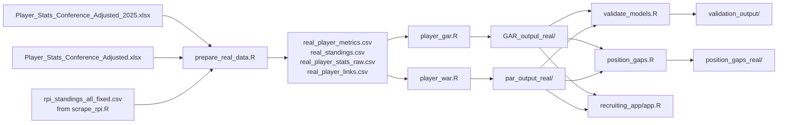

# Men's College Soccer Player Analytics (Virginia Tech)

Player ratings for NCAA D1 men's soccer, built from Wyscout conference-game data, and a
recruiting app that uses them.

| Piece | Question it answers | Script |
|---|---|---|
| **GAR** (goals above replacement) | How many goals does a player add, at both ends, compared with an easy-to-find backup? | `player_gar.R` |
| **PAR** (points above replacement) | How many league points (3 for a win, 1 for a draw) does he add? | `player_war.R` (`OUTCOME <- "points"`) |
| **Validation** | Do the ratings measure something real, and which model is better? | `validate_models.R` |
| **Position gaps** | Where is Virginia Tech furthest behind the top programs? | `position_gaps.R` |
| **Recruiting board** | Search, filter and compare players; see how each rating is calculated | `recruiting_app/app.R` |

## Contents
- [How the pieces fit together](#how-the-pieces-fit-together)
- [Running it](#running-it)
- [Data](#data)
- [GAR](#gar-goals-above-replacement)
- [PAR](#par-points-above-replacement)
- [Validation](#validation)
- [The recruiting app](#the-recruiting-app)
- [Known limitations](#known-limitations)
- [Troubleshooting](#troubleshooting)

---

## How the pieces fit together



## Running it

From the project folder, in R (or `Rscript <file>` in a terminal), in this order:

```r
source("prepare_real_data.R")   # both seasons -> real_*.csv
source("player_gar.R")          # -> GAR_output_real/
source("player_war.R")          # OUTCOME <- "points" -> par_output_real/
source("validate_models.R")     # -> validation_output/ (~5 min with the sensitivity re-runs)
source("position_gaps.R")       # -> position_gaps_real/
shiny::runApp("recruiting_app")
```

Re-run `player_gar.R` and `player_war.R` after any change to the data or weights, then restart the app.

Packages: `readxl`, `readr`, `dplyr`, `tidyr`, `stringr`, `purrr`, `ggplot2`, `glmnet`, `scales`, and for the app `shiny`, `bslib`, `DT`.

---

## Data

### What was sent

| File | What's in it |
|---|---|
| `Player_Stats_Conference_Adjusted_2025.xlsx` | 2025: 4,832 players, 212 teams, 22 conferences |
| `Player_Stats_Conference_Adjusted.xlsx` | 2026 to date: 4,684 players, 207 teams, 22 conferences |
| `rpi_standings_all_fixed.csv` | RPI rank and records for every team, 2015-2026 (made by `scrape_rpi.R`) |

Each workbook has a **Raw** sheet (Wyscout per-90s plus totals, age, height, foot, birth country, portal status) and an **Adjusted** sheet (the same per-90s corrected for conference strength: `adjusted = raw - effect x (conference rating - average)`, changing only stats with a clear conference effect). The models use the Adjusted sheet. The app's Season stats tab shows the Raw numbers.

### What matters for the models
- **Conference games only.** 2025 has about 8-12 games per team. A few teams that went deep in the postseason have up to ~18, so the 2025 export seems to include postseason games. 2026 is still in progress, with about 5-11 games per team.
- **No player id or class year.** `prepare_real_data.R` builds an id from team + name in a player's first season, and he keeps it the next season, also after a transfer. A transfer is matched by name plus at least one of height (within 3 cm), birth country or last season's portal status, and only when exactly one player fits. Of the 2026 players, 2,526 also played in 2025 (2,055 at the same team, 471 transfers). Every match is listed in `real_player_links.csv`.
- **No team results.** Goals for = the players' goals; goals against = the goalkeepers' goals conceded; games = team minutes / 990. The win-loss record comes from the RPI file's conference record, which can lag the export by a game or two.
- **Missing stats:** pressing duels, clearances, loose-ball duels, losses, recoveries, missed balls, progressive passes allowed and team possession. **Extra stats:** shots blocked, goals prevented, save rate and goals conceded.
- The Wyscout "PAdj" interceptions and sliding tackles stand in for the per-30-minutes-of-opponent-possession versions.
- Check `real_team_name_map.csv` once. It shows how each Wyscout team name ("Virginia Tech Hokies") was matched to the RPI name ("Virginia Tech"). Fix any mistakes in `TEAM_FIXES` in `prepare_real_data.R`.

---

## GAR (goals above replacement)

GAR is a **net rating in goals**: credit for helping the team score and for helping it concede less. In the app, the **How it's calculated** tab shows every step below with the selected player's own numbers.

```
GAR per 90 = attack vs an average player at his position
           + defense vs an average player at his position
           + (average player - replacement-level player) at his position
GAR        = GAR per 90 x minutes / 90
```

1. **Stats.** Per-90 stats from conference games, already adjusted for conference strength.
2. **Small samples are pulled toward average.** Each stat is blended with the position average as if the player had also played 270 minutes at average level (`PRIOR_MIN`). Goals prevented (GK) gets 1,800 minutes, because shot-stopping over a few games is mostly luck. A stat missing from the data counts as the position average.
3. **Attack: sharing the team's chances.** A team's chances are measured in non-penalty xG, and each one is split between shooter and passer. The passer gets 40% of the xG of every shot he sets up (his xA; `PASSER_SHARE`). The shooter keeps the rest. We don't know which of his shots were assisted, so his team's assisted share (team xA / team xG) is used. Summed over a team, the credits add back up to its xG, so nothing is counted twice. Each npxG is worth `XG_GOAL_VALUE` goals, measured from the data: college players scored 0.93 non-penalty goals per npxG (0.945 in 2025, 0.912 in 2026). Attack = his credit minus the average credit at his position.
4. **Defense: stats weighted by goals saved.** The defensive stats in `gar_weights_real.csv` (side = defense) get a weight in goals. A ridge regression across all team-seasons (about 420) asks how many fewer goals per game a team concedes when its players at a position are above average on each stat. The `direction` column fixes whether a stat helps or hurts, and the data picks the size. A weight of 0 means the data found no clear link. Defense = weight x (his value - position average), summed. Wingers and forwards have no defensive stats, so their defense part is 0.
5. **Replacement level.** A replacement-level player is the 20th percentile of players at the position with 270+ minutes that season (`REPL_PCTL`). The gap between an average player and replacement level is the same for everyone at a position, so it's credit for playing time.

**Why attack and defense are measured against average, not replacement:** replacement level is defined for the whole player. Separate 20th percentiles for attack and defense would describe a player who's poor at both, which is worse than a typical backup and would inflate everyone's GAR. Averages add up cleanly, so the split happens at average and the replacement adjustment is applied once.

Each player's rating also gets an **80% range** from the sampling noise of each stat (counts, percentages and xG behave differently), combined using the weights. The app's "chance he's better" numbers come from these ranges.

### Outputs (`GAR_output_real/`)

| File | Contents |
|---|---|
| `player_gar.csv` | GAR, its three parts (`off_gaa`, `def_gaa`, `repl_value`), per-90 versions, 80% ranges, ranks |
| `gar_breakdown.csv` | Every player's stat-by-stat contribution (what the app's calculation tab shows) |
| `gar_replacement.csv` | Average and replacement level per position and season |
| `model_settings.csv` | The settings used for this run |
| `weights_used.csv` | Final weights, plus `goals_per_season_1sd`: goals over 1,800 minutes from being 1 standard deviation above average on that stat |
| `team_gar.csv` | Team GAR, attack and defense totals, goals for and against per game |
| `our_roster.csv`, `portal_vs_roster.csv` | Virginia Tech's regulars, and every other player compared with our weakest regular at his position |
| `01`-`04` charts, `by_position/`, `vs_roster/` | Top 25, attack vs defense, VT vs top programs, team ratings vs goals |

---

## PAR (points above replacement)

PAR is the same idea measured in **league points** (3 for a win, 1 for a draw), built from **3-4 stat categories per position** (for a CB: defending, aerial, passing & progression, goal threat).

1. **Stats and small-sample blending**, as in GAR, using the stats listed in `par_categories.csv`.
2. **0-1 scale.** Within each position and season, the 5th-percentile value = 0 and the 95th = 1 (`SCALE_LO`, `SCALE_HI`). Players beyond them keep going past 0 or 1 (`CAP_SCALE <- FALSE`). Stats where fewer is better (cards) are flipped, so higher is always better.
3. **Categories.** Each category score is a weighted average of its stats on that scale (`weight_in_category`).
4. **Category weights.** A ridge regression across all team-seasons (about 420) asks how much higher a team's **Massey rating** is when its players at a position are above average in each category (`TARGET <- "massey"`). Massey uses every game and the opponents, so it's a steadier target than a 5-12 game conference record. One Massey point is worth about 0.79 league points per game (fitted from the same teams), which turns the weights into points. Weights can't be negative. `TARGET <- "outcome"` fits to conference points per game instead (the old way).
5. **PAR per 90** = Σ category weight x (his category score - position average) + (average - replacement level). **PAR** = PAR per 90 x minutes / 90.
6. **80% ranges** from each stat's sampling noise, as in GAR, so the app shows a "chance he's better" for PAR too.

### Changing what PAR values: `par_categories.csv`

This is the file to edit. One row per stat:

| Column | Meaning |
|---|---|
| `position`, `category`, `stat` | Which stat counts in which category at which position (stat names are defined in section 3 of `player_war.R`) |
| `direction` | +1 more is better, -1 fewer is better, 0 leave it out |
| `weight_in_category` | How much the stat counts inside its category (2 = twice as much as a 1) |
| `fixed_points_per_season` | Blank = learned from the data. A number = set the category's value yourself, in league points over a full season (1,800 minutes) for going from the position's 5th- to 95th-percentile player in that category. Put the same number on every row of the category |
| `note` | What the stat is |

**To see what PAR currently values, open `par_output_real/par_weights.csv`.** For every position and category: whether it was learned or fixed, `points_per_season_category` (same units as `fixed_points_per_season`, so you can copy a learned value and adjust it), each stat's share and value, and `points_per_season_per_unit`: what one more of the stat per 90 (or one more % point) is worth over a season.

Outputs (`par_output_real/`): `player_par.csv` (with 80% ranges), `par_weights.csv`, `par_breakdown.csv`, `par_replacement.csv`, `model_settings.csv`, `team_par.csv`, charts.

### Key settings (both scripts)

| Setting | Real-data value | Meaning |
|---|---|---|
| `WEIGHTS_FILE` | `gar_weights_real.csv` / `par_categories.csv` | Which stats count at each position, and whether more is good (+1) or bad (-1) |
| `WEIGHT_MODE` | `learned` | `learned`, or `manual` (GAR: `manual_weight` from the CSV; PAR: every category needs `fixed_points_per_season`) |
| `TARGET` | `massey` | PAR: fit the category weights to Massey ratings, or `outcome` for conference points per game |
| `XG_GOAL_VALUE` | `NA` (measured, 0.93) | GAR: goals per non-penalty xG |
| `PRIOR_MIN` | 270 | Small-sample blending strength |
| `MIN_QUAL` | 270 | Minutes to count toward averages, scaling and replacement level |
| `REPL_PCTL` | 0.20 | Replacement-level percentile |
| `PASSER_SHARE` | 0.40 | GAR: share of an assisted chance credited to the passer |
| `FIT_EXCLUDE` | 2020 | Seasons left out of the weight fit |
| `ADJUST_SOS` | `FALSE` | Schedule adjustment; off because the Adjusted sheet already corrects for conference strength |

---

## Validation

`validate_models.R` asks questions the models weren't fitted to, and compares GAR and PAR with simple baselines (raw goal difference, xG + xA per 90, ...). Checks 1-5 run on each season and pooled. With both seasons (latest run):

| Check | GAR | PAR | Best baseline |
|---|---|---|---|
| Non-conference results (games not in the data), 2025-2026 pooled | 0.50 | 0.49 | 0.38 |
| Massey team ratings, pooled | 0.70 | 0.71 | 0.60 |
| Rating repeats next season, within position | 0.30 | 0.32 | 0.14 |
| Rating repeats next season, transfers only | 0.30 | 0.35 | 0.07 |
| Weights fitted on 2025 only, rating 2026 teams | 0.44 | 0.45 | 0.44 (weights from both seasons) |

Also: reliability, team-strength leak, coaches' playing-time choices, sensitivity to settings, a next-season forecast (2025 ratings of the 2026 roster vs 2026 results), and GAR vs PAR agreement. Results go to `validation_output/` (`validation_report.txt`, `validation_compare.csv`, charts 00-08). An optional `awards.csv` (player_name, team, award; start from `awards_template.csv`) adds an awards check.

---

## The recruiting app

`shiny::runApp("recruiting_app")`. Pick a season, filter by position, conference and portal status, and click a player. The header shows his flag, position and team (and his previous team after a transfer), with links to switch between his seasons. Tabs:

- **Head to head:** GAR and PAR against our weakest or best regular at his position, or any player, plus a radar of his key skills.
- **Skills:** percentile of every Wyscout stat at his position.
- **Season stats:** raw Wyscout numbers by season.
- **How it's calculated:** his GAR or PAR taken apart: the equation with his numbers, a waterfall chart of every stat's contribution, a stat-by-stat table, and a plain-language walk through each step.
- **History & info:** GAR per 90 by season, a season-by-season table, and player details.

Country flags are in `recruiting_app/www/CountryFlags/<CODE>.png`, matched by birth country (`COUNTRY_CODES` in `app.R`).

---

## Known limitations

- **Small samples.** 5-12 conference games a season, so ratings repeat only moderately from year to year (r ≈ 0.3). Compare tiers, not exact ranks.
- **Team-quality bias.** Learned weights can favor stats that rise when the whole team is good. Player ratings follow team strength at about 0.3 (rank correlation), against 0.1 for simple stats.
- **Defensive stats.** Many defensive weights come out at 0: volume stats like interceptions go with being under pressure as much as with defending well. Win-rate stats (duel and aerial win %) carry most of the defense.
- **Wingers and forwards** earn no defensive credit in GAR (no pressing or recovery stats in the export).
- **Goalkeepers.** Goals prevented over a few games is mostly luck, so it's heavily blended toward average.
- **2026 is in progress** but is included in the weight fits and replacement levels.

## Troubleshooting

| Error | Cause | Fix |
|---|---|---|
| `Weights file not found` | `WEIGHTS_FILE` doesn't match a file in the folder | Check the name |
| `... uses stats that aren't defined` | A stat in the weights CSV isn't built in section 3 of the script | Add it to the `mutate()` in section 3, or fix the typo |
| `Can't find player_gar.csv` (app) | The models haven't been run, or the app can't find their folders | Run `player_gar.R` and `player_war.R`, or set `GAR_DIR` / `PAR_DIR` in `app.R` |
| "Re-run player_gar.R to add the breakdown" (app) | Outputs from before the calculation tab existed | Re-run `player_gar.R` and `player_war.R` |
