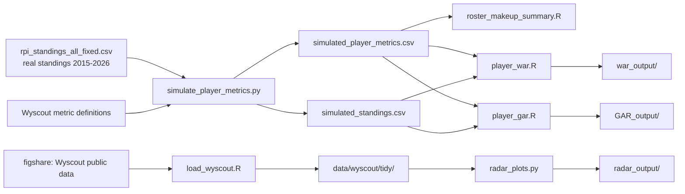

# Men's College Soccer Player Analytics

Tools for rating NCAA Division I men's soccer players and comparing Virginia Tech with the country's top programs. The project has four parts:

| Part | What it answers | Main files |
|---|---|---|
| **RPI and roster exploration** | How are top programs' rosters built, and how does Virginia Tech compare? | `roster_makeup_summary.R` |
| **WAR** (wins above replacement) | How many wins did each player add compared with a backup? | `player_war.R` |
| **GAR** (goals above replacement) | How many goals did each player add in attack and save in defense? | `player_gar.R` |
| **Radar plots** | What does a player's statistical profile look like next to his peers? | `load_wyscout.R`, `radar_plots.py` |

> **Status:** player-level data for college soccer isn't available yet. The rating models currently run on **simulated** player data built around the real RPI standings, and the radar plots run on Wyscout's **public 2017–18 European data**. Nothing produced from simulated data says anything about real players or teams; it exists to build and test the methods before real data arrives.

---

## Contents

- [How the pieces fit together](#how-the-pieces-fit-together)
- [Data sources](#data-sources)
- [Setup](#setup)
- [1. Simulated player data](#1-simulated-player-data)
- [2. RPI and roster exploration](#2-rpi-and-roster-exploration)
- [3. WAR](#3-war-wins-above-replacement)
- [4. GAR](#4-gar-goals-above-replacement)
- [5. The scorecard](#5-the-scorecard-testing-the-methods)
- [6. Radar plots (Wyscout)](#6-radar-plots-wyscout-data)
- [Switching to real data](#switching-to-real-data)
- [Known limitations and next steps](#known-limitations-and-next-steps)
- [Troubleshooting](#troubleshooting)

---

## How the pieces fit together



---

## Data sources

### Real RPI standings: `rpi_standings_all_fixed.csv`

| | |
|---|---|
| Seasons | 2015–2026 (2026 in progress; last update 10/19/2026) |
| Rows | 2,375 team-seasons (188–213 teams per season) |
| Teams / conferences | 222 teams, 27 conferences (incl. Independents) |
| Key columns | `rpi_rank`, `sos_rank`, overall and conference W-L-T, quadrant records (Q1–Q4), records vs. top 100 and below 150 |

Notes:
- 2020 (COVID) is excluded from model fitting by default.
- A few 2018 ACC rows have no strength-of-schedule rank; the scripts fill these with the conference's usual value.
- The 2026 season is incomplete, so its records are based on fewer games.
- The file has no goals for or against. Those are needed for GAR on real data (see [Switching to real data](#switching-to-real-data)).

### Simulated player data: `simulated_player_metrics.csv` and `simulated_standings.csv`

Made by `simulate_player_metrics.py` for every team-season in the RPI file. See [section 1](#1-simulated-player-data).

| | |
|---|---|
| Rows | 64,125 player-seasons (27-man rosters) |
| Columns | 17 player/team context columns + 78 Wyscout-style metrics + `true_talent` |
| Positions | GK, CB, FB, DM, CM, AM, W, CF |
| Names | Fake. Two players can share a name, so always use `player_id` |

### Wyscout public event data (2017–18)

The public dataset released with Pappalardo et al. (2019), *A public data set of spatio-temporal match events in soccer competitions*, hosted on figshare. It covers the 2017–18 Premier League, La Liga, Bundesliga, Serie A and Ligue 1, plus Euro 2016 and the 2018 World Cup, with every on-ball event (passes, shots, duels and so on) and its pitch coordinates. It's used here only as realistic test data for the radar plots.

---

## Setup

**R** (4.1 or newer):

```r
install.packages(c("readr", "dplyr", "tidyr", "purrr", "ggplot2", "glmnet", "scales",
                   "jsonlite", "stringi", "cowplot"))
```

**Python** (3.9 or newer):

```bash
python -m pip install numpy pandas mplsoccer
```

`simulate_player_metrics.py` needs only `numpy` and `pandas`. `radar_plots.py` also needs `mplsoccer`, which installs `matplotlib`.

Run the scripts from the repository's root folder. The R scripts look for their input CSVs in the current folder (`DATA_DIR <- "."`).

---

## 1. Simulated player data

```bash
python simulate_player_metrics.py rpi_standings_all_fixed.csv simulated_player_metrics.csv 42 metric_definitions.txt simulated_standings.csv
```

Arguments: standings file, player output file, random seed, the Wyscout metric definitions list (sets the column order), and the standings output file. The same seed always gives the same data.

### How it's built

1. **Team strength.** Each team-season gets a strength score from its real RPI rank (75%) and win % (25%). Stronger teams get more possession, more shots, better passing and fewer defensive actions. Each team also gets random style traits, *direct* and *pressing*, so equally strong teams still differ.
2. **Rosters that carry over.** Players move up a class each year (Fr → So → Jr → Sr → Gr), some leave, and recruits fill each position. Recruits' talent tracks program strength, and returning players improve by about 0.18 talent per year.
3. **Playing time.** Depth charts are set by talent, with some randomness and injuries. Every team's minutes add up to 11 × 90 per game.
4. **Stats.** Each metric starts from a position baseline. It's then shifted by team strength, the player's talent, a permanent personal tendency and noise, with smaller samples noisier. Derived stats are built from their parts so everything is consistent: goals never exceed shots, and successful attacking actions equal shots on target + accurate crosses + successful dribbles.
5. **Team results.** Every team's games are simulated one by one. Team quality comes from program strength, the minutes-weighted talent of the players who actually played, and schedule difficulty, so better players really do cause more winning. The simulated results match real college soccer: a win % spread of about 0.18 and a tie rate of about 16.5%. RPI rank is re-estimated from the simulated records.

### `true_talent`, the answer key

The last column is the hidden talent value that produced each player's stats that season. **Never use it as a model input.** It exists only to grade methods (see [the scorecard](#5-the-scorecard-testing-the-methods)). Real data has no equivalent.

### `simulated_standings.csv`

Simulated W-L-T, goals for and against, and re-estimated RPI rank, with the real record and rank kept alongside (`real_w`, `real_rpi_rank` and so on) for comparison. The real file's detailed splits (conference, quadrant) are dropped, because they wouldn't match the simulated results.

### What the simulation can't tell you

- Which stats actually matter in soccer. Any relationship a model finds is one the simulation put there.
- Anything about real players, teams, conferences or trends over time.
- How attack and defense separate. Each team has one overall quality, so a great CB raises goals scored as much as he lowers goals conceded.

---

## 2. RPI and roster exploration

`roster_makeup_summary.R` compares roster construction across six RPI tiers:

| Tier | Ranks |
|---|---|
| 1–10 | 1–10 |
| 11–25 | 11–25 |
| 26+ Q1 – Q4 | Teams ranked 26th and lower, split into four equal groups within each season |

- **Position groups:** D (CB, FB), M (DM, CM, AM), F (W, CF). Goalkeepers are excluded.
- **Who counts:** players with more than 25% of the minutes of their team's most-used player.
- **Output:** `roster_group_summary.csv`, with team-seasons, mean, median, SD, min, Q25, Q75 and max players per team-season for each tier and position group, plus a season-by-season Virginia Tech table.

Charts used with this summary:
- **Bar chart of means with Q25–Q75 error bars**, faceted by position group, in a maroon gradient from darkest (1–10) to lightest (26+ Q4).
- **Boxplots of every team-season**, with Virginia Tech's seasons overlaid.

On simulated data all tiers look the same, because every simulated team uses the same 27-man roster template. The analysis is ready for real rosters.

**Ideas still to explore:** minutes concentration (how much of the minutes go to the top 11 or 14 players), experience (minutes-weighted class year), roster continuity (share of minutes returning), transfers vs. homegrown players, freshman minutes, production by position group, and finding which elite rosters Virginia Tech's most resembles.

---

## 3. WAR (wins above replacement)

```bash
Rscript player_war.R                                    # uses the settings in the file
Rscript player_war.R war_weights_original.csv manual    # weights file, mode (optional)
```

### How it works

1. **Build each position's stats** per 90 from the raw columns. Defensive volume stats are adjusted to a 50%-possession game, and ball losses to the team's own possession.
2. **Shrink small samples.** Each player is treated as if he also played 270 minutes at his position's average, so a 100-minute player can't post extreme numbers.
3. **Adjust for strength of schedule.** For each stat, the effect of a tougher schedule (at the same win %) is measured and removed.
4. **Scale each stat from 0 to 1** within position and season, using the 5th and 95th percentiles of players with 300+ minutes. Values outside that range are capped.
5. **Learn the weights.** For each team-season, players' above- or below-average stats are summed, weighted by minutes. A ridge regression predicts team win % from these sums plus schedule strength.
   - The `direction` column fixes each weight's sign: +1 means the weight can't be negative, −1 means it can't be positive.
   - The penalty strength is chosen by leaving out one season at a time.
   - `manual` mode uses `manual_weight` from the CSV instead, and the data converts each position's total into wins.
6. **Index, replacement level and WAR.**
   - **Index** = Σ weight × scaled stat. Because the weights were fitted to win %, the index is already in wins per 90 minutes.
   - **Replacement level** = the 20th-percentile index among players with 300+ minutes at the same position and season.
   - **WAR** = (index − replacement) × minutes / 90.
   - **WAA** (wins above average) is the same, measured against the position average instead.

### Weight files

| File | Contents |
|---|---|
| `war_weights_original.csv` | The original stat list: goals, assists, and both volume and percentage versions of duels and aerials |
| `war_weights_compiled.csv` | One stat per idea: **xG** replaces goals and shots, **xA** replaces assists and chances created, and defenders use **win %** for duels and aerials. Each changed row has a note |

Columns: `position`, `stat`, `direction` (+1 good, −1 bad, 0 excluded), `manual_weight`, `note`. Every stat name must be defined in section 3 of the script, or the script stops and names the missing stat.

### Key settings

| Setting | Default | Meaning |
|---|---|---|
| `STANDINGS_FILE` | `simulated_standings.csv` | Use `rpi_standings_all_fixed.csv` with real player data |
| `WEIGHTS_FILE` | `war_weights_compiled.csv` | Which stat list |
| `WEIGHT_MODE` | `learned` | `learned` or `manual` |
| `MIN_QUAL` | 300 | Minutes to count toward scaling and replacement level |
| `PRIOR_MIN` | 270 | Shrinkage strength |
| `REPL_PCTL` | 0.20 | Replacement-level percentile |
| `FIT_EXCLUDE` | 2020 | Seasons left out of the weight fit |
| `FOCUS_TEAM` | Virginia Tech | Team highlighted in charts |
| `LATEST` | 2025 | Season shown in charts |
| `VERSION` | `""` | Scorecard label; blank = automatic, e.g. "war_weights_compiled (learned)" |

### Outputs (`war_output/`)

| File | Contents |
|---|---|
| `player_war.csv` | WAR, WAA, WAR per 90, ranks overall and within position |
| `team_war.csv` | Team WAR and WAA with win %, games and schedule |
| `weights_used.csv` | Final weights, plus `wins_per_season_5_to_95`: wins added over 1,800 minutes by going from the 5th- to the 95th-percentile player on that stat |
| `01_top25_war.png` | Top 25 players in `LATEST` |
| `02_team_vs_top_programs_by_position.png` | Virginia Tech vs. RPI 1–10 and 11–25 teams, average WAR by position, last five seasons |
| `03_team_war_vs_win_pct.png` | Team WAR vs. win % |
| `04_war_year_to_year.png` | WAR per 1,000 minutes, one season vs. the next |
| `05_team_war_vs_rpi.png` | Team WAR vs. RPI rank (rank 1 at the top) |
| `06_scorecard.png`, `07_scorecard_history.png`, `scorecard*.csv` | See [the scorecard](#5-the-scorecard-testing-the-methods) |

---

## 4. GAR (goals above replacement)

```bash
Rscript player_gar.R
Rscript player_gar.R gar_weights.csv manual
```

GAR is a **net rating in goals**: players are credited for helping their team score and for helping it concede less. Steps 1–6 are identical to WAR. The difference is that there are **two weight fits**:

- **Attack:** attacking stats → team goals scored per game
- **Defense:** defensive stats → team goals conceded per game. The fit uses goals *prevented*, so positive is always good.

Each player's GAR has three parts:

| Part | Meaning |
|---|---|
| **Attack** (`off_gaa`) | Goals added compared with an average player at his position |
| **Defense** (`def_gaa`) | Goals prevented compared with an average player; negative means below-average defending |
| **Average over replacement** (`repl_value`) | How much better an average player is than a replacement-level backup, times his minutes. The per-90 value is the same for everyone at a position in a season, so this piece is credit for playing time |

**GAR** = attack + defense + average over replacement = (net index − replacement index) × minutes / 90.

**Why attack and defense are measured against average, not replacement:** replacement level is defined for the whole player, the 20th-percentile player *overall*. Separate 20th percentiles for attack and defense would describe a player who's poor at both, which is worse than a typical backup and would inflate everyone's GAR. Averages add up cleanly, so the split happens at average and the replacement adjustment is applied once.

`war_equiv` converts GAR to wins using the team-level link between goal difference and wins: about 0.22 wins per goal, or 4.6 goals per win, in the simulated data.

### Weight file: `gar_weights.csv`

Same as `war_weights_compiled.csv`, plus a **`side`** column (`attack` or `defense`). Judgment calls that are easy to change:
- CB and GK pass accuracy is attack (build-up play).
- Ball losses, cards and pressing are defense.
- Winger aerials are attack; CM and CB aerials are defense.

### Outputs (`GAR_output/`)

| File | Contents |
|---|---|
| `player_gar.csv` | GAR, its three parts, per-90 versions, `war_equiv`, ranks |
| `team_gar.csv` | Team GAR, attack and defense totals, goals for and against per game |
| `weights_used.csv` | Weights by side, plus `goals_per_season_5_to_95` |
| `01_top25_gar.png` | Top 25, with each bar split into attack, defense and replacement value |
| `02_attack_vs_defense.png` | Attack vs. defense per 90 for every regular, Virginia Tech labeled |
| `03_team_vs_top_programs.png` | Virginia Tech vs. top programs by position, attack and defense separately |
| `04_team_ratings_vs_goals.png` | Team attack rating vs. goals scored; team defense rating vs. goals conceded |
| `05_scorecard.png`, `06_scorecard_history.png`, `scorecard*.csv` | See [the scorecard](#5-the-scorecard-testing-the-methods) |

---

## 5. The scorecard: testing the methods

The team-level checks (team WAR vs. win %, team GAR vs. goal difference) show that ratings add up at the team level, but not that individual players get the right credit. Because the weights are fitted to team results, those checks are also partly built in. The scorecard grades methods on **players**, using the simulation's `true_talent`. Players with 600+ minutes are included and 2020 is left out.

| Measure | Meaning |
|---|---|
| **WAR (or GAR) vs. true talent, team strength removed** | **Main score.** Does the rating find good players, not just players on good teams? |
| Rating vs. true talent | The same without removing team strength |
| Rating vs. team strength | How tied the rating is to team quality |
| True talent vs. team strength | The amount of team link that's expected, since good programs recruit better players. A rating well above this is crediting players for their team |

It also records held-out R², year-to-year repeatability, and team-level correlations. Every run is saved to `scorecard_history.csv` under its `VERSION` label, and the history chart compares versions. On real data the scorecard skips itself.

**Current results (simulated data, average main score across positions):**

| Version | Main score | Year-to-year r | Held-out R² |
|---|---|---|---|
| WAR, compiled weights, learned | **0.538** | 0.69 | 0.58 (win %) |
| WAR, original weights, learned | 0.535 | 0.68 | 0.57 (win %) |
| WAR, compiled weights, manual (all = 1) | 0.487 | 0.70 | — |
| GAR, learned | 0.491 | 0.56 | 0.49 attack / 0.28 defense |

GK (≈0.2) and CB (≈0.3) are the weakest positions for every version.

---

## 6. Radar plots (Wyscout data)

### Step 1: load the data in R

```r
source("load_wyscout.R")
```

This downloads the five figshare files (once), reads the chosen competition **directly from the zip files** (nothing is unzipped to disk), builds tidy tables, and saves them as compressed CSVs in `data/wyscout/tidy/<COMPETITION>/`.

| Setting | Default | Meaning |
|---|---|---|
| `COMPETITION` | `England` | `England`, `France`, `Germany`, `Italy`, `Spain`, `European_Championship`, `World_Cup` |
| `SAMPLE_MATCHES` | 100 | Keep the first N matches by date (about 10 Premier League rounds); `NULL` = whole season |
| `COMPRESS_CSV` | `TRUE` | Save `.csv.gz` files, several times smaller |
| `DELETE_DOWNLOADS` | `FALSE` | Delete the zip files after saving, to free the most space (they're downloaded again on the next run) |

Tables created: `competitions`, `teams`, `players`, `matches`, `match_teams`, `lineups`, `substitutions`, `events`.

`events` has start and end coordinates (0–100, with the team in possession attacking left to right), all tags, ready-made `is_goal`, `is_accurate`, `is_assist` and `is_key_pass` flags, and player and team names.

Quirks of the dataset that the loader handles:
- Escaped accents in names, such as `Sánchez`, are decoded.
- The card fields hold the *minute* of the card (0 = none), so they're named `yellow_minute` and `red_minute`.
- Some teams' substitutions are stored as the text "null"; these are skipped.

### Step 2: make the plots in Python

```bash
python radar_plots.py --list                                  # every player you can plot (forwards)
python radar_plots.py --list --position Midfielder
python radar_plots.py --list kane                             # search any name, any position
python radar_plots.py --player "Mohamed Salah"
python radar_plots.py --player "Harry Kane" "Mohamed Salah" --adjusted
python radar_plots.py --position Midfielder --player "Kevin De Bruyne"
```

You can also edit the `SETTINGS` block at the top and run the file without arguments, for example in Spyder.

**The nine stats**, all per 90:

| Group | Stats |
|---|---|
| Shooting | Non-penalty xG, non-penalty goals |
| Passing | Assists, key passes, smart passes, passes ending in the final third, passes received in the final third |
| Duels | Attacking ground duels won, air duels won |

**Reading the plot:** slice size is the player's percentile among players at the same position with more than 400 minutes; the label on each slice is his actual per-90 value. `--adjusted` adjusts each stat for his team's share of the ball while he was on the pitch. That roughly doubles the values, so compare percentiles rather than raw numbers.

**How the stats are calculated:**
- **Minutes** come from lineups and substitutions; a red card ends a player's minutes.
- **xG** is a logistic regression on shot distance and angle, with separate models for headers and other shots.
- **Final-third receptions** only count when the next touch is by a teammate.
- **Names** match on short ("H. Kane") or full ("Harry Kane") names, ignoring accents and capitals. When several players match, the one in the chosen position wins.

**Outputs (`radar_output/`):** one PNG per player, `summary_<competition>.csv` (every player's totals, per-90s and possession), and `players_<competition>_<position>.csv` from `--list`.

The data is the **2017–18 season**. With `SAMPLE_MATCHES = 100`, only roughly August–October 2017 is included, so a player who missed that stretch won't appear.

---

## Real data (Wyscout export, 2026)

### What was sent

| File | What's in it | Used for |
|---|---|---|
| `Player_Stats_Conference_Adjusted.xlsx` | 4,684 players, 207 teams, 22 conferences. Sheet **Raw** = Wyscout per-90s plus totals, age, height, foot, portal status. Sheet **Adjusted** = the same per-90s corrected for conference strength (`adjusted = raw - effect x (conference rating - 7.74)`; only stats with a clear conference effect are changed). Also Adjustment Factors, Conference Ratings (Massey), Notes. | The models (main input) |
| `wyscout_complete_positions.xlsx` | The original export, one sheet per conference (117 columns, incl. market value and portal date), plus team position counts. The Team Positions sheet is Excel formulas, so it reads as empty outside Excel. | Optional extras: market value, portal date |
| `Top30_Massey_Team_Makeup.xlsx` | Massey ratings 2022-2026 for all teams, the top 30 programs' roster makeup, and Massey-to-Wyscout team names. | Roster-tier work (not the models) |

What matters for the models:
- **One season, conference games only:** 2026 to date, about 5-11 games per team (max 1,205 minutes).
- **No player id or class year.** `prepare_real_data.R` builds an id from team + name.
- **No team results.** Goals for = the players' goals; goals against = the goalkeepers' goals conceded; games = team minutes / 990. The win-loss record comes from the RPI file's conference record, which can lag the export by a game or two.
- **Missing stats:** pressing duels, clearances, loose-ball duels, losses, recoveries, missed balls, progressive passes allowed and team possession. **New stats:** shots blocked, goals prevented, save rate and goals conceded.
- The Wyscout "PAdj" interceptions and sliding tackles stand in for the per-30-minutes-of-opponent-possession versions.

### Running it

```r
source("prepare_real_data.R")   # writes real_player_metrics.csv, real_standings.csv, real_team_name_map.csv
source("player_gar.R")          # DATA_SOURCE <- "real" (the default) -> GAR_output_real/
source("player_war.R")          # -> war_output_real/
shiny::runApp("recruiting_app") # DATA_SOURCE <- "real" in app.R
```

Set `DATA_SOURCE <- "simulated"` in any of the three to go back to the simulated files. Those results are unchanged.

With `DATA_SOURCE "real"`, the models use:
- `gar_weights_real.csv` / `war_weights_real.csv`: the missing stats are removed. Shots blocked (CB, FB, DM) and goals prevented (GK) are added, and DM gains duel and aerial win %.
- `ADJUST_SOS <- FALSE`, because the Adjusted sheet already corrects for conference strength.
- Lower minute cut-offs (MIN_QUAL 270, COMPARE_MIN 360).
- 10 random groups of teams for cross-validation, instead of leaving out one season.
- Goals prevented: fixed at 1 goal per goal (`FIXED_WEIGHTS`) and shrunk with 1,800 prior minutes (`STAT_PRIOR_MIN`), because a keeper's shot-stopping over 8 games is mostly luck.

Check `real_team_name_map.csv` once. It shows how each Wyscout team name ("Virginia Tech Hokies") was matched to the RPI name ("Virginia Tech"). Fix any mistakes in `TEAM_FIXES`.

### Validating without an answer key
The scorecard turns itself off on real data. Use instead:
- year-to-year stability, once there is a second season
- whether team GAR tracks team goal difference (printed when the model runs)
- agreement with outside judgments: All-Conference and All-American teams, MLS draft picks, pro signings
- the coaching staff's view of the top players at each position

---

## Known limitations and next steps

- **Team-quality bias.** Learned weights favor stats that rise when the whole team is good, such as passes and pass accuracy. WAR is more tied to team strength (≈0.46) than true talent is (≈0.29).
- **Defensive stats.** Volume stats like clearances go with losing, because teams under pressure make more of them. The direction rule stops negative weights but can only set these to zero. Win-rate stats (duel and aerial win %) work better.
- **GAR position balance.** Wingers and forwards have no defensive stats, so they earn no defensive credit. Big defensive weights also give CBs a large replacement bonus. Planned fix: add pressing (and possibly ball losses) as defensive stats for W and CF.
- **Capping at the 95th percentile.** Every player above the 95th percentile on a stat gets the same score, so the method can't separate great from exceptional on a single stat.
- **Schedule adjustment direction.** The adjustment uses whatever direction the data shows. On simulated data it lowers tough-schedule players' numbers; check the signs on real data.
- **Goalkeepers.** Shots faced is excluded because it reflects the whole defense. Saves, goals conceded and errors aren't in the data, so GK ratings are weak.
- **2026** is still in progress but is included in fits and replacement levels. Consider adding it to `FIT_EXCLUDE` until the season ends.

**Possible next steps:**
- Hybrid weights: set defensive and GK weights by hand and learn the rest.
- A cross-position replacement level.
- Separate attack and defense quality in the simulation, to test GAR properly.
- R versions of the radar plots.

---

## Troubleshooting

| Error | Cause | Fix |
|---|---|---|
| `numpy.dtype size changed, may indicate binary incompatibility` | Packages built for different NumPy versions | `python -m pip install --upgrade --force-reinstall numpy pandas` |
| `AttributeError: _ARRAY_API not found` (traceback mentions `pyarrow`) | An old `pyarrow` built for NumPy 1 | `python -m pip install --upgrade pyarrow`, or `python -m pip uninstall pyarrow` (not used here) |
| `Weights file not found` | `WEIGHTS_FILE` doesn't match a file in `DATA_DIR` | Check the name, e.g. `war_weights_compiled.csv` |
| `... uses stats that aren't defined` | A stat in the weights CSV isn't built in section 3 | Add it to the `mutate()` in section 3 or fix the typo |
| `needs goals_for and goals_against columns for GAR` | GAR run on standings without goals | Use `simulated_standings.csv`, or add goals to the real standings |
| `'<name>': no player found` (radar) | Not in the saved matches, or a different name form | `python radar_plots.py --list <part of name>`, or set `SAMPLE_MATCHES <- NULL` |
